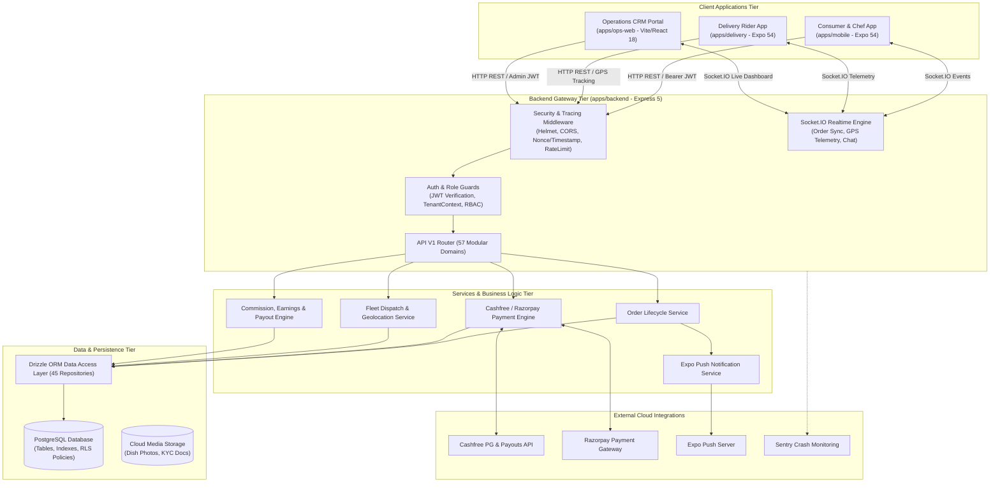
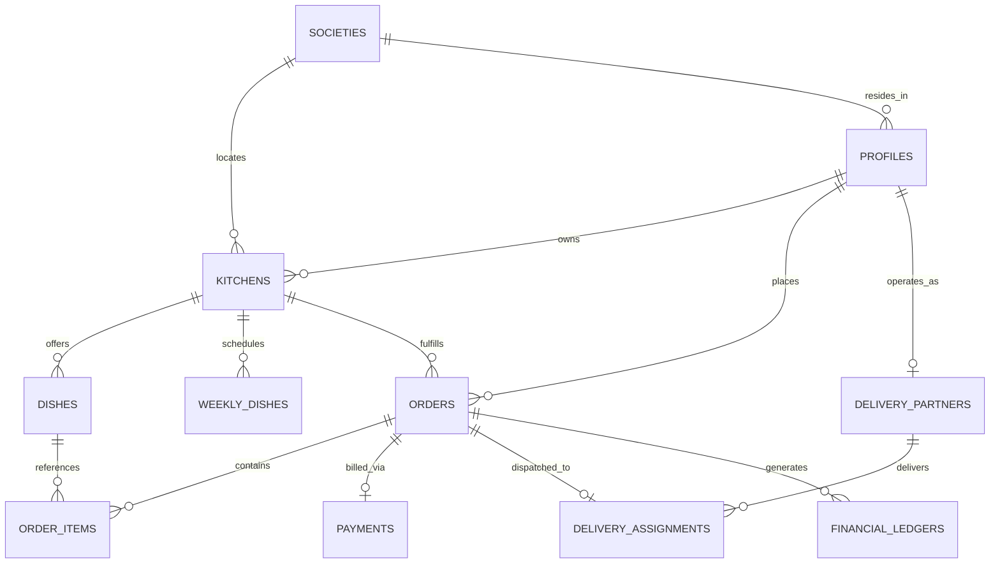
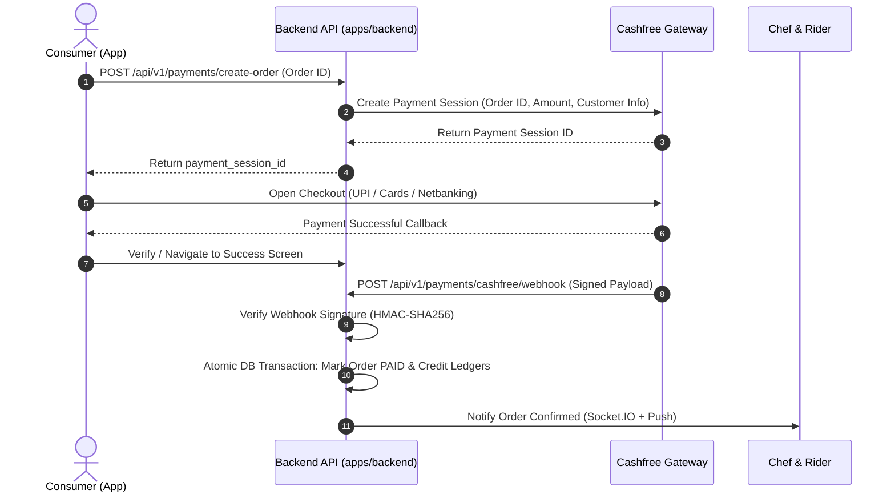

# Society Chef — Full-Stack Food-Tech Platform

> A society-first, multi-application marketplace and on-demand delivery ecosystem connecting residential home chefs, society consumers, dedicated delivery riders, and operations managers.

[](file:///.github/workflows/ci.yml)
[](file:///package.json)
[](file:///apps/mobile/package.json)
[](file:///apps/backend/package.json)
[](file:///supabase/schema.sql)
[](file:///apps/backend/src/db/schema.ts)
[](file:///package.json)

---

## 1. Introduction & Overview

**Society Chef** is an enterprise-grade full-stack food-tech platform engineered as an **npm monorepo** consisting of **four distinct applications**:
1. **[Customer & Home-Chef Mobile App](file:///apps/mobile)**: Cross-platform mobile application for residential food ordering, chef onboarding, dish cataloging, and weekly meal schedule planning.
2. **[Delivery Partner Mobile App](file:///apps/delivery)**: Dedicated mobile application for fleet riders featuring background location tracking, KYC document verification, order dispatch, and earnings ledger.
3. **[Operations CRM & Admin Web Platform](file:///apps/ops-web)**: Real-time administrative command center for dispute management, kitchen hygiene verification, order dispatch oversight, and financial settlements.
4. **[Backend API & Realtime Gateway](file:///apps/backend)**: Multi-tiered REST and WebSocket server with 65 domain controllers, 85 business services, Drizzle ORM data access, and Cashfree/Razorpay payment automation.

The platform targets residential gated communities and apartment complexes, empowering passionate home chefs to operate compliant micro-kitchens while providing neighbors with fresh, authentic, home-cooked meals.

---

## 2. Problem Statement & Intended Users

### The Problem
Traditional food delivery platforms (Swiggy, Zomato) impose high commissions (25%–35%), prioritize commercial cloud kitchens, and demand high minimum order thresholds. Meanwhile, talented home cooks face steep operational barriers around licensing, order dispatching, logistics, packaging supplies, and secure payment collection within their immediate neighborhoods.

### Intended Users
- **Society Residents (Consumers)**: Seek fresh, hygienic, home-cooked regional dishes and customized weekly meal subscriptions from neighbors within their housing complex.
- **Home Chefs**: Residential homemakers and culinary enthusiasts who need a 1-click branded kitchen storefront with menu scheduling, automated order notifications, and verified bank payouts.
- **Delivery Partners (Riders)**: On-campus and local fleet riders who earn per-delivery incentives with automated GPS dispatch and digital OTP handover.
- **Operations & Support Managers (Admins)**: Platform operators monitoring KYC compliance, food safety hygiene checks, order routing, payment reconciliation, and dispute arbitration.

---

## 3. Project Objectives & Core Use Cases

| Persona | Core Objective | Key Implemented Use Cases |
| :--- | :--- | :--- |
| **Consumer** | Discover & order home meals | • Geofenced search filtered by society, dietary preference (Veg/NonVeg), and prep time.<br>• Weekly meal planner booking for upcoming weekdays.<br>• Direct chat with chefs for dietary customization.<br>• Secure UPI/Card checkout via Cashfree with order tracking. |
| **Home Chef** | Operate a micro-kitchen | • Self-serve kitchen onboarding with flat privacy controls.<br>• Dish catalog management with prep lead-times, tags, and custom add-ons.<br>• Weekly availability scheduling using interactive time-slot pickers.<br>• Real-time incoming order audio/push alerts with accept/reject controls.<br>• Transparent earnings breakdown with automated payout requests. |
| **Delivery Rider** | Execute hyperlocal delivery | • Digital KYC onboarding with Aadhaar, Driving License, and RC upload.<br>• Real-time delivery queue with accept/decline toggles.<br>• Turn-by-turn map navigation and background GPS telemetry updates.<br>• Contactless handoff protected by customer-provided verification PIN/OTP.<br>• Digital wallet displaying tips, delivery fees, and milestone incentives. |
| **Operations Team** | Ensure trust & platform health | • Real-time live dashboard monitoring GMV, order velocity, and system alerts.<br>• Document verification portal for rider KYC and chef kitchen approvals.<br>• Financial arbitration suite for processing partial/full refunds and ledger adjustments.<br>• Role-Based Access Control (RBAC) governing administrative permissions. |

---

## 4. Main Features Grouped by Application

### Customer & Home-Chef App (`apps/mobile`)
- **Dual-Persona Architecture**: Role switcher seamlessly toggling between Consumer browsing and Home-Chef management.
- **Weekly Meal Scheduler**: Interactive calendar component (`components/weekly-planner/`) allowing chefs to schedule availability periods for specific days of the week.
- **Party Catering Engine**: Bulk catering pack builder with per-head dynamic pricing and quote requests.
- **Direct Messaging**: In-app Socket.IO chat thread connecting customers and chefs directly for delivery coordination.
- **Hyperlocal Geofencing**: Automatic society discovery filtering dishes within walking or short scooter distance.
- **Cart & Pricing Engine**: Multi-item shopping cart with automatic society discounts and free-sampling coupon engine.

### Delivery Partner App (`apps/delivery`)
- **Fleet Dispatch Queue**: Audio/visual modal alerts notifying available riders of pickup assignments.
- **Digital KYC Portal**: Multi-step document uploader for Aadhaar Card, Driving License, and Vehicle Registration Certificate (RC).
- **Live GPS Telemetry**: Continuous location beacon streaming coordinates to both the backend and customer tracking screen.
- **Secure Handover Verification**: Order completion gated behind a verification OTP to guarantee handoff accuracy.
- **Gamified Incentives**: Tiered leaderboard ranking top-performing delivery partners with milestone bonuses.

### Operations CRM Web Portal (`apps/ops-web`)
- **Fleet Command Center**: Live interactive table displaying all active riders, their current GPS coordinates, status, and assigned orders.
- **Trust & Compliance Suite**: Side-by-side document inspection view for rapid KYC approval or flagged rejection with canned reason codes.
- **Financial Ledger & Dispute Resolver**: Double-entry ledger tracking platform commission, chef payout obligations, and dispute arbitration.
- **Society Manager**: Interactive management for housing society geofences, unit counts, and coverage zones.
- **Extensive Test Coverage**: 800 automated Playwright test cases verifying functional workflows, destructive input sanitization, and sub-second SLA compliance.

### Backend API & Realtime Gateway (`apps/backend`)
- **65 Domain Controllers & 57 Route Modules**: Complete RESTful coverage of all platform capabilities under `/api/v1`.
- **Drizzle ORM Relational Schema**: 90.7 KB type-safe database definition spanning 50+ relational entities and foreign keys.
- **State Machine Order Management**: Rigid transaction states preventing illegal status jumps (`PENDING` ➔ `CONFIRMED` ➔ `PREPARING` ➔ `READY` ➔ `OUT_FOR_DELIVERY` ➔ `DELIVERED`).
- **Automated Payout Engine**: Integration with Cashfree Payouts API and Razorpay for direct bank IMPS/NEFT transfers.
- **Hardened Security Middleware**: Request replay protection (nonce + timestamp verification), reverse-proxy rate limiting, Helmet headers, and CORS whitelist.

---

## 5. Technology Stack & Architectural Decisions

| Layer / Technology | Choice | Version | Rationale |
| :--- | :--- | :--- | :--- |
| **Backend Runtime** | Node.js / Express | Express `5.2.1` | Battle-tested, lightweight HTTP pipeline with async route handling, native Promise support, and wide middleware ecosystem. |
| **Database ORM** | Drizzle ORM | `0.45.3` | Zero-overhead, type-safe SQL query generation without heavyweight engine overhead, perfectly paired with PostgreSQL. |
| **Database Engine** | PostgreSQL (Supabase / Neon) | `15+` | Relational integrity, ACID transaction guarantees for financial ledgers, and Row-Level Security (RLS) enforcement. |
| **Realtime WebSockets** | Socket.IO | `4.8.4` | Low-latency bi-directional messaging with fallback transports, authenticated user rooms, and connection recovery. |
| **Mobile Runtime** | Expo SDK / React Native | Expo `54.0.37` / RN `0.81.5` | Native Android and iOS performance from a unified TypeScript codebase, leveraging Expo Router v6 and EAS build pipelines. |
| **Web Admin Runtime** | React 18 / Vite 5 | React `18.3.1` / Vite `5.3.1` | Sub-millisecond HMR during development and optimized production bundles for administrative dashboard workflows. |
| **Web Styling** | Tailwind CSS v4 | `4.3.2` | High-productivity utility classes for high-density tables, modal sheets, and operational status chips. |
| **Client State** | Zustand | `5.0.13` | Minimalist, unopinionated reactive state management with AsyncStorage persistence and zero boilerplate. |
| **Server Query Cache** | TanStack React Query | `5.100.10` | Automatic background data refetching, mutation lifecycle hooks, and optimistic UI updates. |
| **Payment Gateways** | Cashfree & Razorpay | Custom REST / SDK | Redundant payment collection supporting Indian payment rails (UPI, Cards, Netbanking) and automated IMPS merchant payouts. |
| **Crash Telemetry** | Sentry Profiling | `10.65.0` | Real-time distributed tracing, memory profiling, and exception capturing across backend, web, and mobile. |
| **Push Notifications** | Expo Server SDK | `6.1.0` | Native push delivery to Android and iOS devices without requiring complex custom APNS/FCM setup. |

---

## 6. Architecture Overview

### High-Level System Architecture



---

## 7. Repository Directory Structure

```text
Societychef-fullstack-web-application/
├── .agents/                               # Workspace agent customization rules, workflows, and skills
│   ├── rules/graphify.md                  # Knowledge graph navigation rules
│   └── skills/                            # Supabase and Postgres optimization skills
├── .github/
│   └── workflows/
│       └── ci.yml                         # Automated GitHub Actions CI pipeline
├── apps/
│   ├── backend/                           # Node.js Express 5 & Socket.IO API server
│   │   ├── Dockerfile                     # Container specification for production deployment
│   │   ├── drizzle.config.ts              # Drizzle ORM migration configuration
│   │   ├── railway.json                   # Railway cloud deployment manifest
│   │   ├── package.json                   # Backend dependencies and scripts
│   │   ├── src/
│   │   │   ├── app.ts                     # Express setup, middleware, and Sentry integration
│   │   │   ├── server.ts                  # Server entry point and HTTP/WebSocket listener
│   │   │   ├── config/                    # Environment validation (Zod) and Supabase client
│   │   │   ├── controllers/               # 65 HTTP request handlers
│   │   │   ├── db/                        # Drizzle schema (schema.ts), relations, connection pool
│   │   │   ├── integrations/              # Cashfree client and external provider registry
│   │   │   ├── middleware/                # Auth, RBAC, Idempotency, Maintenance, Tracing
│   │   │   ├── realtime/                  # Socket.IO connection manager and room dispatch
│   │   │   ├── repositories/              # 45 database query repositories
│   │   │   ├── routes/                    # 57 endpoint route modules mounted under /api/v1
│   │   │   ├── services/                  # 85 domain business logic and financial engines
│   │   │   └── utils/                     # Winston logger, error classes, response formatters
│   │   └── tests/                         # API and unit test suites
│   ├── delivery/                          # Delivery Partner (Rider) Expo mobile app
│   │   ├── app/                           # Expo Router file-based route tree
│   │   │   ├── (auth)/                    # Rider login and onboarding screens
│   │   │   ├── (main)/                    # Active order queue, KYC submission, Profile
│   │   │   └── (wallet)/                  # Rider earnings ledger and payout requests
│   │   ├── api/                           # 24 client-side API modules
│   │   ├── constants/                     # Config constants, map settings, API defaults
│   │   ├── store/                         # Zustand state stores (auth, orders, location)
│   │   └── app.json                       # Android package: com.societychef.delivery
│   ├── mobile/                            # Consumer & Home-Chef Expo mobile app
│   │   ├── app/                           # Expo Router file-based route tree
│   │   │   ├── (consumer)/                # Food discovery, cart, checkout, order tracking
│   │   │   ├── (chef)/                    # Kitchen dashboard, menu editor, weekly planner
│   │   │   └── landing.tsx                # Visual onboarding showcase screen
│   │   ├── components/                    # WeeklyPlanner, CheckoutModal, UI atoms
│   │   ├── lib/apiClient.ts               # Production Railway API client with auto-refresh
│   │   ├── store/                         # Zustand stores (useAuthStore, useCartStore, etc.)
│   │   └── app.json                       # Android package: com.societychef.app
│   └── ops-web/                           # Operations CRM & Admin web platform
│       ├── src/
│       │   ├── pages/                     # 25 portal views (Dashboard, Delivery, Finance, Trust)
│       │   ├── api/axios.ts               # Axios client with JWT injection and security headers
│       │   └── components/                # Modals, drawers, tables, badges
│       ├── tests/playwright/              # 8 automated E2E test suites (800 test cases)
│       ├── vite.config.ts                 # Vite development server and bundling config
│       └── tailwind.config.js             # Tailwind CSS styling configuration
├── docs/                                  # Centralized project documentation hub
│   ├── requirements.md                    # Canonical Product Requirements Document (PRD)
│   ├── tech-stack.md                      # Technical stack and security guidelines
│   ├── API_DOCUMENTATION.md               # REST API specification catalog
│   ├── delivery-kyc-crm-flow.md           # Rider KYC verification specification
│   ├── delivery-rider-onboarding.md       # Rider onboarding guide
│   ├── paid_features_api_requirements.md  # Commercial APIs and infrastructure cost breakdown
│   └── play_store_release_audit.md        # Google Play Store Android 14 compliance audit
├── supabase/                              # Database architecture and migration scripts
│   ├── schema.sql                         # Canonical Postgres schema definition
│   ├── seed.sql                           # Initial seed dataset (dishes, societies, kitchens)
│   ├── migrations/                        # 38 production SQL migration files
│   └── local/                             # 27 portable SQL migration modules
├── .env.example                           # Sanitized global environment template
├── .gitignore                             # Monorepo ignore rules
├── package.json                           # Root workspace definition and coordination scripts
└── package-lock.json                      # Monorepo lockfile
```

---

## 8. Detailed Application Breakdown

### 1. Consumer & Home-Chef Mobile App (`apps/mobile`)
- **Framework**: React Native with Expo SDK 54, Expo Router v6.
- **Key Files**:
  - [`app/_layout.tsx`](file:///apps/mobile/app/_layout.tsx): Top-level application shell wiring `QueryClientProvider`, Sentry, and authentication observers.
  - [`app/(consumer)/discover.tsx`](file:///apps/mobile/app/(consumer)/discover.tsx): Hyperlocal food discovery feed with filter chips, search, and kitchen cards.
  - [`app/(chef)/dashboard.tsx`](file:///apps/mobile/app/(chef)/dashboard.tsx): Home-chef operational command view displaying active orders and revenue stats.
  - [`components/weekly-planner/WeeklyPlanner.tsx`](file:///apps/mobile/components/weekly-planner/WeeklyPlanner.tsx): Interactive scheduling calendar allowing chefs to configure weekday availability.
  - [`lib/apiClient.ts`](file:///apps/mobile/lib/apiClient.ts): Network gateway communicating with the Railway production backend, complete with request nonces and automatic session refresh.

### 2. Delivery Partner Mobile App (`apps/delivery`)
- **Framework**: React Native with Expo SDK 54, React Native Maps, Expo Task Manager.
- **Key Files**:
  - [`app/(main)/home.tsx`](file:///apps/delivery/app/(main)/home.tsx): Rider dispatch view with online/offline availability switch and order acceptance cards.
  - [`app/(main)/profile.tsx`](file:///apps/delivery/app/(main)/profile.tsx): 57.5 KB comprehensive rider profile with KYC status inspection, performance badges, and vehicle details.
  - [`app/(main)/kyc/`](file:///apps/delivery/app/(main)/kyc): Dedicated document upload flow for Aadhaar Card, Driving License, and Vehicle RC.
  - [`api/client.ts`](file:///apps/delivery/api/client.ts): Client API layer handling automatic token refresh and authenticated rider network requests.

### 3. Operations CRM Web Portal (`apps/ops-web`)
- **Framework**: React 18, Vite 5, Tailwind CSS v4, Zustand 5, Playwright.
- **Key Files**:
  - [`src/pages/Dashboard.tsx`](file:///apps/ops-web/src/pages/Dashboard.tsx): High-level operational metrics (GMV, active kitchens, daily order volume).
  - [`src/pages/Delivery.tsx`](file:///apps/ops-web/src/pages/Delivery.tsx): 28.1 KB fleet operations command center with live rider status and assignment tracking.
  - [`src/pages/Finance.tsx`](file:///apps/ops-web/src/pages/Finance.tsx) & [`Payments.tsx`](file:///apps/ops-web/src/pages/Payments.tsx): Comprehensive financial management for customer refunds, dispute arbitration, and audit-logged wallet adjustments.
  - [`src/pages/Trust.tsx`](file:///apps/ops-web/src/pages/Trust.tsx): 20.1 KB safety portal for reviewing kitchen hygiene checklists and approving/rejecting rider KYC submissions.
  - [`tests/playwright/`](file:///apps/ops-web/tests/playwright): 8 automated test suites containing 800 test cases with 100% pass rate.

---

## 9. Backend Structure & Code Organization

The backend (`apps/backend`) follows a strict **layered enterprise architecture**:

```text
Request ──► Middleware ──► Router ──► Controller ──► Service (Engines) ──► Repository ──► Database
```

### Layer Responsibilities
- **Middleware (`src/middleware/`)**:
  - [`api_security.middleware.ts`](file:///apps/backend/src/middleware/api_security.middleware.ts): Enforces replay attack prevention via `X-Request-Timestamp` (within 5 min window) and `X-Request-Nonce`.
  - [`auth.middleware.ts`](file:///apps/backend/src/middleware/auth.middleware.ts): Validates incoming JWT Bearer tokens and extracts user context.
  - [`rbac.middleware.ts`](file:///apps/backend/src/middleware/rbac.middleware.ts): Verifies role permissions (`requireRole(['admin', 'super_admin'])`).
  - [`tenant.middleware.ts`](file:///apps/backend/src/middleware/tenant.middleware.ts): Resolves multi-tenant society context via `x-tenant-id`.
  - [`idempotency.middleware.ts`](file:///apps/backend/src/middleware/idempotency.middleware.ts): Caches mutation requests via `x-idempotency-key` to prevent duplicate billing.
- **Controllers (`src/controllers/`)**: 65 controllers that parse HTTP inputs, validate schemas, invoke domain services, and return standardized responses via `sendSuccess` or `sendError`.
- **Services & Domain Engines (`src/services/`)**: 85 services containing business logic:
  - [`order.service.ts`](file:///apps/backend/src/services/order.service.ts): 19.8 KB order lifecycle orchestrator (order creation, validation, transitions, push notifications).
  - [`commission.engine.ts`](file:///apps/backend/src/services/commission.engine.ts): Calculates platform commission tiers (e.g. 10%–15%) and chef earnings.
  - [`cashfree.service.ts`](file:///apps/backend/src/services/cashfree.service.ts): Cashfree payment gateway integration and automated merchant payouts.
- **Repositories (`src/repositories/`)**: 45 repositories abstracting Drizzle ORM database operations away from business logic.
- **Database Schema (`src/db/schema.ts`)**: Exhaustive 90.7 KB Drizzle ORM schema defining over 50 tables with PostgreSQL types and relations.

---

## 10. Database Schema, Migrations, and Data Flow

### Database Architecture
The platform relies on a normalized PostgreSQL schema managed through both raw SQL migration scripts (`supabase/migrations/`) and Drizzle ORM definitions (`apps/backend/src/db/schema.ts`).

### Key Entity Relational Model



### Migrations Inventory
The `supabase/migrations/` folder houses **38 versioned migration scripts**:
- `000_combined_schema.sql` to `010_fix_weekly_dishes.sql`: Core marketplace tables, triggers, and weekly schedule definitions.
- `20260801000000_production_rls_security.sql`: Row-Level Security (RLS) enforcement restricting profile and kitchen updates to resource owners.
- `006_financial_core.sql`: Double-entry accounting tables and the atomic `execute_financial_transaction` function.
- `20260909000000_create_payments_cashfree.sql`: Payment tables supporting Cashfree session tokens and webhook event tracking.
- `20260920000001_lock_down_orders_authorization.sql`: Hardened database authorization restricting order modifications strictly to authorized actors.

---

## 11. Authentication, Authorization & RBAC

### Authentication Pipeline
1. **Phone + OTP Authentication**: Consumers and home chefs authenticate by submitting an Indian phone number. An OTP is verified to issue a JWT session.
2. **Admin Authentication**: Administrators authenticate with email and bcrypt-hashed password credentials at `/api/v1/auth/admin-login`.
3. **Session Refresh**: Clients automatically exchange `refresh_token` payloads at `/api/v1/auth/refresh` without interrupting active workflows.

### Role-Based Access Control (RBAC) Matrix
The platform enforces a five-tier hierarchy stored in `public.profiles.role`:

| Role | Scope | Permitted Endpoints & Capabilities |
| :--- | :--- | :--- |
| `consumer` | Customer | Browse dishes, manage cart, place orders, chat with chef, review deliveries. |
| `chef` | Micro-Kitchen | Onboard kitchen, edit menus, schedule weekly dishes, view settlements. |
| `rider` | Delivery Partner | Access dispatch queue, submit GPS telemetry, execute OTP handovers, view tips. |
| `admin` | Operations Staff | Approve rider KYC, manage disputes, trigger refunds, view fleet tracking. |
| `super_admin` | Platform Owner | Full system configuration, RBAC assignment, platform setting overrides. |

---

## 12. Payment Workflows & Webhooks

### Dual Payment Gateway Architecture
The platform integrates **Cashfree** as its primary payment processor and **Razorpay** as a secondary option:



### Automated Payout Engine
- **Settlement Ledger**: When an order transitions to `DELIVERED`, the platform calculates the chef's net earnings after deducting platform commission.
- **Payout Transfers**: Handled via Cashfree Payouts API or manual bank transfer approvals in the Ops CRM (`apps/ops-web/src/pages/Settlements.tsx`).

---

## 13. Maps, GPS Telemetry & Real-Time Sync

- **Interactive Maps**: Powered by `react-native-maps` on mobile and Leaflet/DOM mapping in the Ops CRM.
- **Background Location Tracking**: The delivery app registers an Expo Task Manager service continuously reading `expo-location` coordinates in the background.
- **Telemetry Ingestion**: GPS coordinates are posted to `POST /api/v1/delivery/assignments/:id/tracking`, persisting to `delivery_tracking` and broadcasting live via Socket.IO.
- **Real-Time Customer Updates**: The consumer tracking screen subscribes to Socket.IO events to display the rider's live icon moving toward the delivery address.

---

## 14. API Documentation & Core Endpoint Groups

The backend exposes over 100 endpoints across 65 controllers. Primary groups include:

| Group | Base Route | Purpose & Key Methods |
| :--- | :--- | :--- |
| **Auth** | `/api/v1/auth` | `POST /send-otp`, `POST /verify-otp`, `POST /refresh`, `POST /admin-login` |
| **Kitchens** | `/api/v1/kitchens` | `GET /`, `POST /`, `GET /:id`, `PATCH /:id`, `POST /:id/toggle-live` |
| **Dishes** | `/api/v1/dishes` | `GET /`, `POST /`, `GET /:id`, `PATCH /:id`, `DELETE /:id` |
| **Weekly Dishes**| `/api/v1/weekly-dishes` | `GET /consumer`, `GET /chef/:chefId`, `POST /`, `DELETE /:id` |
| **Orders** | `/api/v1/orders` | `POST /`, `GET /`, `GET /:id`, `PATCH /:id/status`, `POST /:id/cancel` |
| **Payments** | `/api/v1/payments` | `POST /create-order`, `POST /cashfree/webhook`, `POST /verify` |
| **Delivery** | `/api/v1/delivery` | `GET /queue`, `POST /assignments/:id/accept`, `POST /assignments/:id/tracking` |
| **CRM Partners** | `/api/v1/crm/delivery-partners` | `GET /`, `POST /:id/kyc/approve`, `POST /:id/kyc/reject` |
| **Finance** | `/api/v1/finance` | `GET /ledgers`, `POST /adjustments`, `POST /refunds` |
| **Settlements** | `/api/v1/settlements` | `GET /breakdown`, `POST /payout-requests`, `POST /process` |

*For extended documentation, see [`docs/API_DOCUMENTATION.md`](file:///docs/API_DOCUMENTATION.md).*

---

## 15. Installation & Local Development

### Prerequisites
- **Node.js**: `20.x` LTS recommended
- **npm**: `10.x+` (uses npm workspaces)
- **Git**: Configured with line endings (`core.autocrlf = true` on Windows)
- **Expo CLI & EAS CLI**: `npm install -g eas-cli` (optional for local builds)

### 1. Clone the Repository
```bash
git clone https://github.com/SachinPandey2005/Societychef-fullstack-web-application.git
cd Societychef-fullstack-web-application
```

### 2. Install Dependencies
Because of non-standard peer dependency ranges in the backend, dependencies should be installed using the `--legacy-peer-deps` flag:
```bash
npm install --legacy-peer-deps
```

### 3. Environment Variable Configuration
Copy the provided environment templates and supply valid development credentials:
```bash
# Monorepo root environment
cp .env.example .env

# Backend environment
cp apps/backend/.env.example apps/backend/.env

# Mobile app environment
cp apps/mobile/.env.example apps/mobile/.env
```

Ensure the following key variables are set in `apps/backend/.env`:
```ini
PORT=8080
NODE_ENV=development
DATABASE_URL=postgresql://postgres:[PASSWORD]@[HOST]:5432/postgres
JWT_SECRET=your_jwt_secret_key_minimum_32_characters
CORS_ORIGIN=http://localhost:5173,http://localhost:8082,http://localhost:19006
```

---

## 16. Development Commands

The root `package.json` provides convenience scripts leveraging npm workspaces:

| Command | Action |
| :--- | :--- |
| `npm run dev:backend` | Starts the Express API server with hot-reload on port `8080` (`ts-node-dev`). |
| `npm run dev:mobile` | Starts the Expo development server for the Consumer/Chef mobile app. |
| `npm run dev:ops-web` | Starts the Vite development server for the Ops CRM portal on port `8082`. |
| `npm run install:all` | Installs dependencies across all workspaces. |
| `npm run graph:update` | Updates the Graphify AST knowledge graph across the repository. |
| `npm run graph:viz` | Exports the interactive HTML dependency visualizer. |

### Running the Delivery Partner App
Navigate to the delivery directory to start its Expo development server:
```bash
cd apps/delivery
npx expo start
```

---

## 17. Build, Test, and Quality Assurance

### Backend Testing & Type-Checking
```bash
cd apps/backend

# Run TypeScript compilation check
npm run build

# Run unit and integration tests (Jest)
npm test

# Run ESLint validation
npm run lint
```

### Ops Web CRM Automated E2E Testing (Playwright)
The Ops portal contains an exhaustive **800-test-case Playwright suite** covering network fault injection, RBAC access controls, and boundary inputs:
```bash
cd apps/ops-web

# Execute the complete automated test suite
npm run test:playwright

# View detailed test execution and trace reports
npm run test:playwright:report
```

### Mobile App Static Type-Checking
```bash
cd apps/mobile
npm run typecheck
```

---

## 18. Deployment Instructions

### 1. Backend Deployment (Railway)
The backend is configured for deployment on [Railway](https://railway.app) via [`apps/backend/railway.json`](file:///apps/backend/railway.json) or Docker:
- **Build Command**: `npm run build`
- **Start Command**: `npm start` (runs `node dist/server.js`)
- **Container Spec**: A production multi-stage [`Dockerfile`](file:///apps/backend/Dockerfile) is provided in `apps/backend/`.

### 2. Ops Web Portal (Vercel)
The Ops CRM portal is configured for single-page routing on [Vercel](https://vercel.com) via [`apps/ops-web/vercel.json`](file:///apps/ops-web/vercel.json):
- **Framework Preset**: Vite
- **Root Directory**: `apps/ops-web`
- **Build Command**: `npm run build`
- **Output Directory**: `dist`

### 3. Mobile Applications (Expo Application Services - EAS)
Both `apps/mobile` and `apps/delivery` maintain production [`eas.json`](file:///apps/mobile/eas.json) manifests targeting Android App Bundles (`.aab`) and iOS (`.ipa`):
```bash
# Build production Android bundle for Consumer/Chef app
cd apps/mobile
eas build --platform android --profile production

# Build production Android bundle for Delivery Partner app
cd apps/delivery
eas build --platform android --profile production
```

---

## 19. Security Posture & Hardening

- **Replay Protection**: Non-webhook endpoints validate `X-Request-Timestamp` and `X-Request-Nonce` to defeat replay attempts.
- **Row-Level Security (RLS)**: Enforced across PostgreSQL tables. Consumers cannot inspect other consumers' profiles; chefs cannot access other kitchens' settlements.
- **Service Role Isolation**: Financial mutations and ledger balance updates are executed via dedicated database functions restricted exclusively to `service_role`.
- **Zero Committed Secrets**: All active secrets, API keys, and database passwords are excluded from Git via hardened `.gitignore` rules.
- **HTTP Header Hardening**: Helmet enforces Content Security Policy (CSP), HTTP Strict Transport Security (HSTS), and frame restrictions.

---

## 20. Known Limitations & Architecture Observations

1. **Delivery App CI Pipeline Gap**: The current `.github/workflows/ci.yml` pipeline runs tests for `backend`, `ops-web`, and `mobile`, but currently omits `apps/delivery`.
2. **Fallback URL Configuration**: `apps/delivery/api/client.ts` and `apps/ops-web/src/api/axios.ts` still contain fallback strings pointing to an earlier Render URL if their respective environment variables (`EXPO_PUBLIC_API_URL` or `VITE_API_URL`) are omitted at build time.
3. **Peer Dependency Compatibility**: `apps/backend/package.json` specifies non-standard future version strings (`typescript: ^6.0.3`, `eslint: ^10.6.0`, `jest: ^30.4.2`), necessitating `--legacy-peer-deps` during dependency installation.
4. **Google Play Background Location Policy**: As documented in [`play_store_release_audit.md`](file:///play_store_release_audit.md), `com.societychef.delivery` requests `ACCESS_BACKGROUND_LOCATION`, requiring an in-app disclosure modal and demonstration video approval prior to Google Play release.

---

## 21. Attribution & Engineering Contributions

### Primary Author & Technical Architect
- **Sachin Pandey** ([@SachinPandey2005](https://github.com/SachinPandey2005))
  - Full-stack architecture, repository refactoring, monorepo consolidation, and release publishing.
  - Integration of Drizzle ORM data tier, Cashfree payment processing, and Socket.IO realtime infrastructure.
  - Design of the Graphify knowledge graph and interactive documentation wiki.

### Repository History
- **Fork Origin**: Forked from upstream repository [`haeontherun/societychef`](https://github.com/haeontherun/societychef).
- **Public Submission**: Published to [`SachinPandey2005/Societychef-fullstack-web-application`](https://github.com/SachinPandey2005/Societychef-fullstack-web-application).

---

## 22. Proposed Future Improvements

The following improvements are explicitly identified as **proposed roadmap items**:

- [ ] **Automate Delivery CI**: Add an `apps/delivery` build and type-checking job to `.github/workflows/ci.yml`.
- [ ] **Interactive OpenAPI / Swagger**: Generate automated Swagger UI documentation directly from backend Zod schemas.
- [ ] **Standardize Backend Dependencies**: Align backend `package.json` dependency versions with stable semver releases to eliminate the requirement for `--legacy-peer-deps`.
- [ ] **Harmonize API URL Fallbacks**: Standardize all client fallbacks across `delivery` and `ops-web` to the active Railway backend.
- [ ] **Google Play In-App Disclosure**: Implement the prominent background location modal in `apps/delivery` for Google Play Store compliance.

---

## 23. License

This project is licensed under the [ISC License](file:///package.json).
