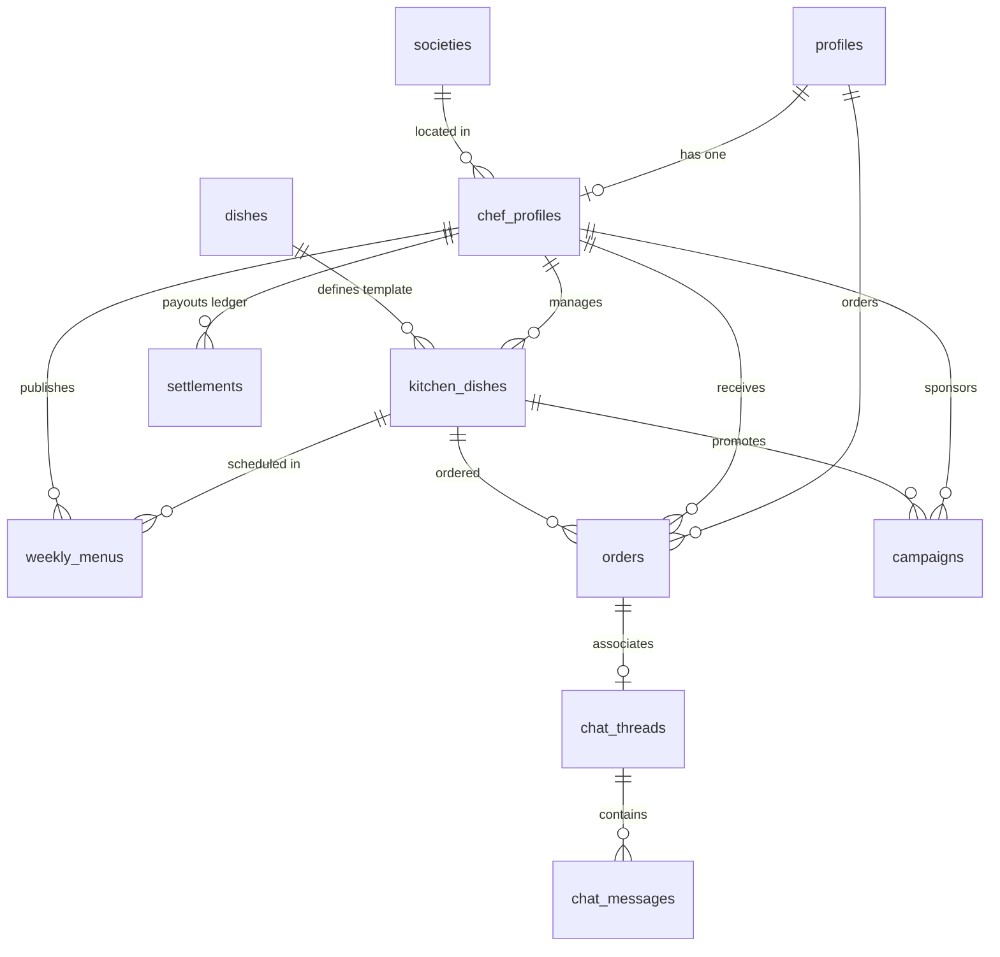

# Project Context: HomeChef (Society Chef)

HomeChef is a society-first, mobile-first marketplace where home cooks (primarily homemakers) can easily set up branded kitchens in their flats and sell fresh, home-cooked food to fellow residents in their housing societies.

---

## 1. Project Directory Structure

```text
societychef/
├── apps/
│   └── mobile/
│       ├── .expo/                   # Expo configuration and build artifacts
│       ├── app/                     # Expo Router file-based routing
│       │   ├── (auth)/              # Authentication screens (phone, OTP, role selection)
│       │   │   ├── _layout.tsx
│       │   │   ├── otp.tsx
│       │   │   ├── phone.tsx
│       │   │   └── role.tsx
│       │   ├── (chef)/              # Chef module routes (dashboard, menu, orders, supplies)
│       │   │   ├── _layout.tsx
│       │   │   ├── dashboard.tsx
│       │   │   ├── menu.tsx
│       │   │   ├── onboarding.tsx
│       │   │   ├── orders.tsx
│       │   │   ├── profile.tsx
│       │   │   ├── settlements.tsx
│       │   │   └── supplies.tsx
│       │   ├── (consumer)/          # Consumer module routes (discovery, orders, chat, rewards)
│       │   │   ├── kitchen/
│       │   │   │   └── [id].tsx        # Kitchen detail page
│       │   │   ├── order/
│       │   │   │   └── [id].tsx        # Order status & details tracking
│       │   │   ├── _layout.tsx
│       │   │   ├── chat.tsx
│       │   │   ├── discover.tsx
│       │   │   ├── notifications.tsx
│       │   │   ├── orders.tsx
│       │   │   ├── profile.tsx
│       │   │   └── rewards.tsx
│       │   ├── (ops)/               # Operations / Management module routes
│       │   │   ├── _layout.tsx
│       │   │   ├── analytics.tsx
│       │   │   ├── index.tsx
│       │   │   └── trust.tsx
│       │   ├── _layout.tsx          # Root provider and layout wrapper
│       │   └── index.tsx            # Initial entry route redirector
│       ├── assets/                  # App icon, splash screen, and media assets
│       ├── components/              # Reusable React Native components
│       │   ├── ui/                  # Atom-level UI styling components (Button, Badge, etc.)
│       │   ├── weekly-planner/      # Component for managing weekly menu schedules
│       │   ├── CheckoutModal.tsx
│       │   ├── ListingCard.tsx
│       │   ├── NotificationBell.tsx
│       │   └── RateOrderModal.tsx
│       ├── constants/               # Color definitions, mock database collections
│       │   ├── colors.ts
│       │   └── data.ts
│       ├── lib/                     # Global utilities (formatting numbers, dates)
│       │   └── format.ts
│       ├── services/                # API and Service layers
│       │   ├── mock/                # Mock DB query operations
│       │   │   └── index.ts
│       │   └── index.ts             # Gateway exporting mock/supabase service API
│       ├── store/                   # Zustand client-state stores
│       │   ├── useAuthStore.ts
│       │   ├── useCartStore.ts
│       │   ├── useNotificationStore.ts
│       │   ├── useReviewStore.ts
│       │   └── useRewardsStore.ts
│       ├── types/                   # TypeScript schemas and definitions
│       │   └── index.ts
│       ├── App.tsx                  # Monolithic legacy prototype view (reference codebase)
│       ├── app.json                 # Expo configuration manifest
│       ├── package.json             # Core dependency registry
│       └── tsconfig.json            # TypeScript configuration
├── docs/                            # Project requirements & architectural guidelines
│   ├── requirements.md              # In-depth MVP scope & acceptance criteria
│   └── tech-stack.md                # Stack details, payments security rules
└── supabase/                        # Backend schema drafts
    └── schema.sql                   # Supabase Postgres database structure
```

---

## 2. Technical Stack & Architecture

### Mobile App (Frontend)
- **Framework**: React Native with **Expo SDK 54** (TypeScript).
- **Navigation**: File-based routing with **Expo Router**.
- **State Management**: **Zustand** stores (`store/`) for client side caching (Cart, Auth, Notifications, Reviews, Rewards).
- **Networking**: TanStack **React Query** (`QueryClientProvider` initialized in root `_layout.tsx`) for API query caching and sync.
- **Styling**: React Native standard `StyleSheet`.
- **Database Gateway (`services/index.ts`)**: Currently routes all client-facing data requests through `services/mock/index.ts` to simulate local latency and provide immediate interactivity. Ready to be redirected to Supabase client services when integrated.

### Backend (Infrastructure Draft)
- **Supabase**: Hosted Postgres database, GoTrue authorization (Phone verification + OTP), and storage buckets for images.
- **Realtime**: For in-app chat thread updates and order delivery tracking.

### Payments Integration
- **Razorpay**: Scheduled to process domestic Indian cards, wallets, and UPI transfers.
- **Verification Security**: The frontend app never marks a payment successful on client callback alone. The transaction follows this sequence:
  1. Backend initiates Razorpay order request.
  2. Frontend opens the Razorpay Native checkout sheet.
  3. App captures response callback.
  4. Backend verifies Razorpay signature via webhooks/endpoints.
  5. Backend updates transaction ledger records and processes settlements.

---

## 3. Core Domain Concepts & Business Logic

* **Hyperlocal Society Focus**: Food listings default to ranking same-society kitchens first, followed by geographic distance and pre-order delivery windows.
* **Same Society Discount**: Orders placed from a consumer inside the same society as the chef are automatically granted a **flat 10% discount** (calculated during the checkout review stage).
* **Chef Identity Privacy**: Chefs can toggle `hideIdentity` in settings. When set to `true`, consumers see only the kitchen brand, society name, approximate distance, and dish list. Personal details (real name, tower, and flat number) are masked until the order goes out for delivery.
* **Weekly Free Dish**: Each active kitchen configuration must nominate one free dish per week (with a capped quantity limit). This acts as a viral entry channel to draw consumer interest.
* **Weekly Food Challenge**: Encourages repeat visits. Every 5 completed orders increments a consumer's challenge counter, triggering a wheel-of-fortune spin for random rewards (discounts, waived delivery fees, free food vouchers).
* **Free Sampling**: Allows chefs to distribute limited portions of newly introduced dishes to collect reviews before committing to a full catalog addition.
* **Kitchen Packaging Supplies**: Integrated marketplace where chefs can purchase platform-standard boxes, tape, envelopes, and stickers directly, separating ledger logic from daily food transaction cycles.

---

## 4. Supabase Database Schema Overview (`supabase/schema.sql`)

The database consists of relational tables capturing the core flow of the marketplace:



### Table Definitions:
1. **`profiles`**: Central user registration directory storing phone numbers, signup dates, and default permissions (`consumer`, `chef`, `ops`).
2. **`societies`**: Standardized directory of recognized apartment complexes, complete with geographical coordinates for delivery routing.
3. **`chef_profiles`**: Linked to `profiles`, listing kitchen names, verification status (hygiene certifications and banking accounts), and visibility preferences.
4. **`dishes`**: Relational catalog of dish templates with platform-suggested default prices and cuisine tagging.
5. **`kitchen_dishes`**: The custom prices, lead preparation times, active statuses, and campaign variables (sample vs. free weekly item) assigned by a specific chef to a template dish.
6. **`weekly_menus`**: Operating schedules detailing what dishes are available on which days and within what delivery hours.
7. **`orders`**: Tracks order statuses (`placed`, `accepted`, `preparing`, `ready`, `out_for_delivery`, `delivered`, `cancelled`), financial splits (fees, discount calculations, delivery costs), and Razorpay transaction hashes.
8. **`settlements`**: Ledger capturing chef earnings, subtracting 10% platform commission and 2% payment gateway overheads.
9. **`campaigns`**: Tracks active promotional campaigns (sampling durations, weekly free items, and food challenge quotas).
10. **`chat_threads` & `chat_messages`**: Safe communication gateway between consumers and chefs to negotiate urgent lead-time delivery requests.
11. **`supply_items` & `supply_orders`**: Store system inventory and tracking details for operational packaging supplies sold to chefs.

---

## 5. Main Application Flow & Routes

### Route Breakdown

#### Authentication: `app/(auth)/`
* **`phone.tsx`**: Input field to receive mobile numbers and trigger OTP delivery.
* **`otp.tsx`**: Numeric passcode check with automatic fallback links for retrying validation.
* **`role.tsx`**: User role selector designating entry into the appropriate layout screen.

#### Consumer Experience: `app/(consumer)/`
* **`discover.tsx`**: Home interface containing a search panel (dish, category, and keyword filters) and lists of recommended local kitchens based on society location.
* **`kitchen/[id].tsx`**: Details page for a kitchen, showing the chef's full menu, ratings, hygiene validation badges, and direct pre-order triggers.
* **`orders.tsx`**: Historical ledger of active and completed orders.
* **`order/[id].tsx`**: Live milestone tracker representing preparation stages and courier logistics.
* **`rewards.tsx`**: Progress bars toward food challenges and wheel-of-fortune reward spinners.
* **`chat.tsx`**: Direct conversation channels to resolve custom cooking requests.
* **`profile.tsx`**: Profile settings, society addresses, and payment details.

#### Chef Dashboard: `app/(chef)/`
* **`onboarding.tsx`**: Step-by-step setup workflow covering kitchen naming, location tagging, private profile configuration, and bank credentials.
* **`dashboard.tsx`**: Live metric panels (gross sales, orders served) and chef task compliance lists.
* **`menu.tsx`**: Catalog control center to configure prices, edit lead preparation times, toggle items on/off, or mark items as free campaigns.
* **`orders.tsx`**: Stage control console to accept incoming requests, update kitchen status (`preparing`, `ready`), and finalize hand-offs.
* **`settlements.tsx`**: detailed payout summary subtracting fees and outlining pending payouts.
* **`supplies.tsx`**: internal shop to buy platform-standard packaging supplies.

#### Operations Panel: `app/(ops)/`
* **`index.tsx`**: High level dashboard showing live counts of active kitchens and weekly free campaigns.
* **`trust.tsx`**: Verification screen to inspect hygiene compliance and bank details.
* **`analytics.tsx`**: Aggregated performance details showing active order ratios and business metrics.

---

## 6. How to Run locally

Make sure you are in `apps/mobile` to execute commands.

1. **Install dependencies**:
   ```powershell
   cd apps/mobile
   npm install
   ```
2. **Start Expo Development Server**:
   ```powershell
   npm start
   ```
3. **Start Web Preview**:
   ```powershell
   npx expo start --web --localhost --port 19006
   ```
